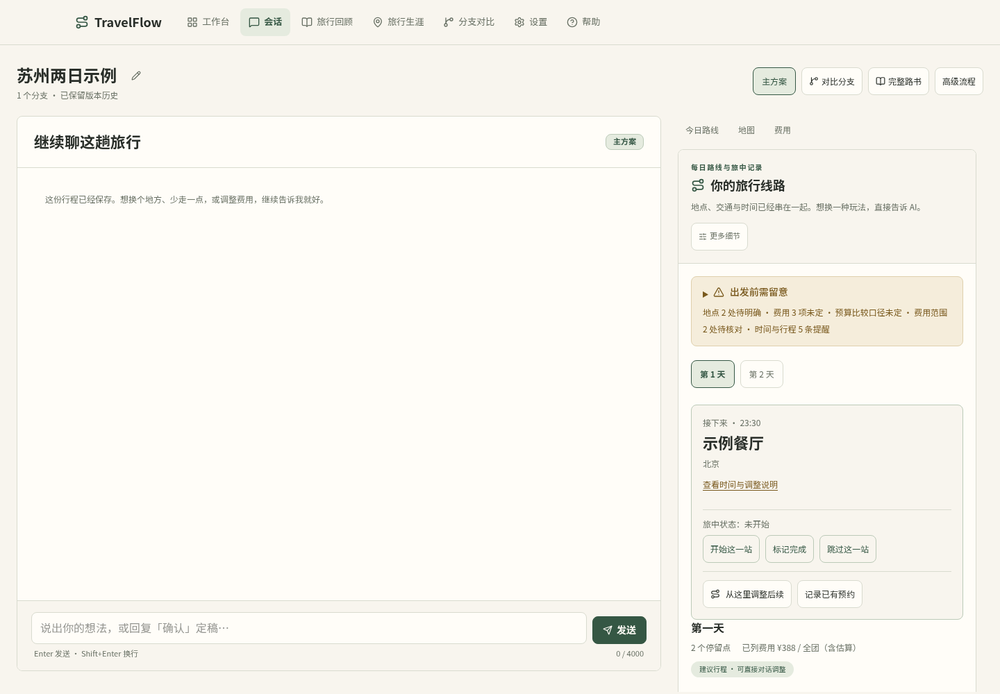
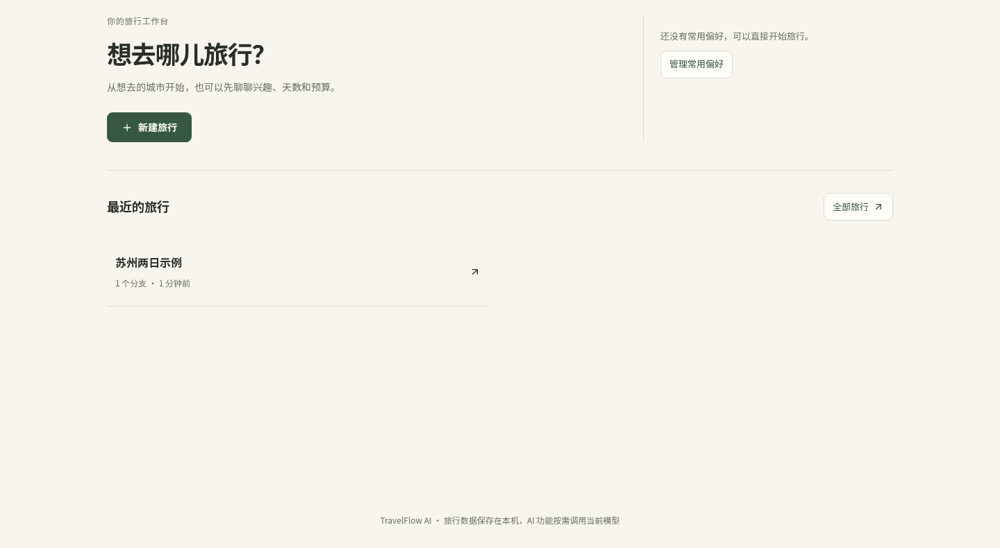
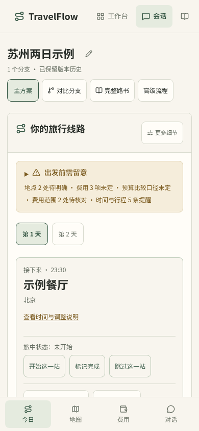
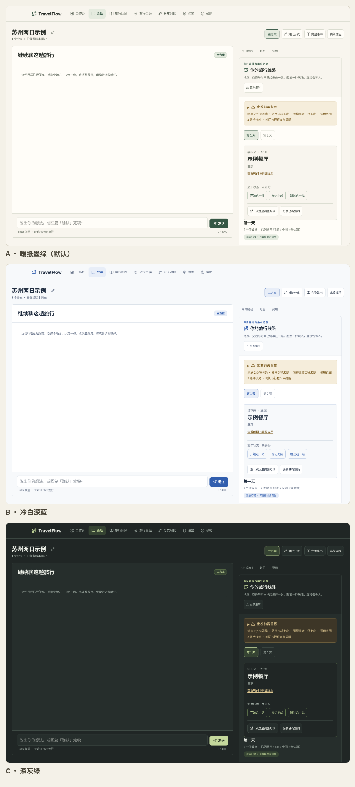

# TravelFlow AI · AI 旅行助手

[](https://github.com/wuqiuwangtian/TravelFlow-AI/actions/workflows/ci.yml)
[](LICENSE)


> 一个跑在**你自己电脑上**的 AI 旅行助手。用对话描述想去哪、玩几天、预算多少，生成可修改的结构化行程；旅途中调整安排、记录实际消费，旅后整理回顾。

TravelFlow AI 面向普通旅行者：规划、执行、记账和回顾使用同一份旅程数据。模型负责理解与建议，金额、日期、预约和记录一致性由程序负责。数据保存在本机 SQLite，模型、检索和地图服务按需调用。



| 工作台 | 手机今日路线 |
| :---: | :---: |
|  |  |



> 截图使用隔离样例数据，不是真实旅行记录。

手机操作与连接条件见[手机浏览器使用](docs/user-guide.md#手机浏览器使用)。独立 Android 客户端在 [TravelFlow-Mobile](https://github.com/wuqiuwangtian/TravelFlow-Mobile) 开发，目前仍是技术原型，尚不能替代本项目使用；本仓库继续维护电脑端与现有网页。

## 功能亮点

- **旅前规划**：城市推荐、按出发地/天数/预算/偏好生成每日行程，支持高德地点、路线、静态地图和地点参考图，导出 Markdown 或单页 HTML。
- **对话修改**：路线、时间、预算和计划书随一句修改同步更新；日期、金额、地点候选和同名消费支持跨轮澄清，失败保留输入与草稿。
- **旅中执行**：标记进行/完成/跳过，从当前位置调整后续，相邻两天联动与同城景点搬移；预约、已完成记录、人工预算和实际账本受保护。
- **费用与凭证**：预估与实际支出放在同一项，退款/报销独立记录，票据图片可选识别；未知费用不等于零，住宿与往返交通等覆盖范围单独提醒。
- **旅后回顾**：按实际记录生成可编辑回顾，支持照片、封面、离线图文导出和 AI 文案草稿；结束后可重新开启，历史版本只读。
- **旅行生涯**：汇总已结束旅行、到访城市与净消费，按城市筛选并回到来源回顾；常用偏好主动保存、显式选用。
- **高级流程**：自由节点工程、八套默认模板、个人模板、分支/汇合、局部重跑、缓存与运行快照，成稿预览后受保护地采用。
- **本地优先**：默认只监听 `127.0.0.1`，API Key 不回显，导出禁用原始 HTML；没有账号体系和云端托管。

详细配置与操作说明见 [使用与配置指南](docs/user-guide.md)，高级工程结构见 [节点工程设计](WORKFLOW_DESIGN.md)。

## 快速开始

### 先装两个工具

| 工具 | 用途 | 版本要求 |
| :--- | :--- | :--- |
| [uv](https://docs.astral.sh/uv/) | 管理后端 Python 依赖 | 0.5 以上 |
| [Node.js](https://nodejs.org/) | 运行前端界面 | 20 以上 |

<details>
<summary>Windows（PowerShell）</summary>

```powershell
powershell -c "irm https://astral.sh/uv/install.ps1 | iex"
winget install OpenJS.NodeJS.LTS
```

装完请关闭并重新打开 PowerShell，用 `uv --version` 和 `node -v` 确认。

</details>

<details>
<summary>macOS</summary>

```bash
brew install uv node
```

</details>

<details>
<summary>Linux / WSL</summary>

```bash
curl -LsSf https://astral.sh/uv/install.sh | sh
sudo apt install nodejs npm   # 或使用发行版包管理器 / nvm 安装 Node 20+
```

</details>

> pnpm 不需要手动安装；启动脚本检测不到时会用 npm 自动安装。

### 启动

```bash
git clone https://github.com/wuqiuwangtian/TravelFlow-AI.git
cd TravelFlow-AI

./start.sh        # macOS / Linux / WSL
start.bat         # Windows：双击运行
```

脚本会检查环境、安装依赖、启动前后端，并在服务就绪后打开浏览器。首次运行需要几分钟安装依赖和编译前端；按 `Ctrl+C` 同时停止（Windows 关闭两个服务窗口）。

没有 API Key 也能先启动，打开界面后到「设置」里配置模型和检索即可。

### 可视运行管理（实验原型）

Windows安装含Tcl/Tk的Python并关联`.pyw`后，可双击根目录的`TravelFlow.pyw`，明确选择Windows原生或WSL发行版、对应源码目录与Python3.13+解释器，再打开管理页面。WSL可填写Linux路径，也可浏览所选发行版的共享目录；入口不会自动安装WSL、解释器或切换运行模式。Linux／WSL仍可运行`python -m desktop console`（需要该环境可用的默认浏览器）。首次准备还需要uv、Node和pnpm；Windows与WSL须各用独立源码与依赖。若默认浏览器未打开，管理器会保留运行；修复本机浏览器设置后重新打开入口即可，不必重复准备环境。

先选择“隔离体验”可以使用虚构服务与独立数据；使用真实数据前，选择已有配置文件并核对实际数据库地址。关闭浏览器标签不会停服务，请在管理页点击停止或退出。Windows原生管理页可选择已有配置／数据库文件；通过Windows统一入口连接WSL后，也可在系统窗口选择当前发行版的文件并回填Linux路径。取消保留原值，跨发行版或盘符地址被拒绝；手动输入仍可用，选择后仍须预览确认。安装包、真实休眠唤醒与数据迁移尚未完成，旧启动入口继续可用；同一时间不要混用新旧入口。更新源码遇到旧管理器提示时，先在原管理页退出；页面丢失时可在对应环境／源码目录运行`python -m desktop console-stop`安全停止，再重开入口。若提示运行选择损坏或实例状态不明，先点“核对并恢复运行状态”：它会找回可认证实例，或保留旧控制记录；不会移动数据库或自动新建主库，之后仍需重新预览确认。

### 手动启动（开发调试）

```bash
# 终端 1：后端
cd backend
cp .env.example .env
uv sync
uv run uvicorn app.main:app --reload --port 8000

# 终端 2：前端
cd frontend
pnpm install
pnpm dev -p 3100
```

访问 <http://localhost:3100>，接口文档在 <http://localhost:8000/docs>。

## 配置

推荐在界面「设置」中配置，保存后立即生效：选择模型服务商、填写 API Key、获取可用模型；检索源和高德地图同理。也可以直接编辑 `backend/.env`，写法见 `backend/.env.example` 注释。

- **大模型**：任何 OpenAI 兼容接口，云端或本地（Ollama、vLLM、LM Studio 等）。
- **信息检索**：DeepSeek 网页搜索、Tavily、博查、百度千帆、SearXNG 或 DuckDuckGo；不配置时生成质量会受影响。
- **高德地图（选填）**：地点定位、路线、静态地图与地点图片；未配置时行程仍可用，但地点与交通保持未核对。

配置项、检索源差异和常见问题见 [使用与配置指南](docs/user-guide.md#配置)。

## 数据与隐私

- 配置保存在 `backend/.env`（含 API Key，请勿提交或分享）；会话、路书、票据与照片保存在 `backend/data/travelflow.db`（SQLite 单文件）。
- 服务默认只监听 `127.0.0.1`，跨域默认严格模式；API Key 永不回显。
- 使用 AI、检索和地图时，会把完成任务所需的内容发送给对应服务；票据图片仅在主动点击识别时发送去除元数据后的预览。
- 导出的 Markdown / HTML 禁用原始 HTML；路书引用链接由程序填入，模型不直接输出 URL。

备份、清空数据和卸载步骤见 [数据、备份与卸载](docs/user-guide.md#数据备份与卸载)。

## 技术栈与结构

| 层 | 技术 |
| :--- | :--- |
| 前端 | Next.js 16 · React 19 · TypeScript · Tailwind CSS 4 |
| 后端 | Python 3.13 · FastAPI · Pydantic v2 · SQLite |
| 编排 | LangGraph（收集 → 检索 → 生成 → 修订） |
| 依赖管理 | uv（Python）· pnpm（前端），均锁定版本 |

```text
TravelFlow-AI/
├── backend/          # FastAPI 服务、LangGraph 编排、SQLite 与导出
├── frontend/         # Next.js 界面
├── docs/             # 用户指南、设计规范、内部开发记录
├── site/             # 静态项目主页（GitHub Pages）
├── start.sh          # Linux / macOS / WSL 一键启动
└── start.bat         # Windows 一键启动
```

## 已知限制

- 依赖外部模型、检索和地图服务，其可用性、价格与输出质量不由本项目保证；请自行核实营业、票价、班次和预约信息。
- 不代订、不提供实时余票、订单或支付能力。
- 实际多日实走、真实手机硬件和外部服务持续可用性属于单独验收范围；自动化测试通过不等于真实旅行体验。
- 未配置高德时地点与交通保持未核对；未列费用不等于零，估算不代表最终价格。
- 票据图片不随文字导出打包；不提供托管服务、在线试用或 SLA。

完整版本说明与升级注意见 [CHANGELOG](CHANGELOG.md) 和 [Releases](https://github.com/wuqiuwangtian/TravelFlow-AI/releases)。

## 参与贡献

- 开发环境、必跑检查和 PR 约定见 [CONTRIBUTING](CONTRIBUTING.md)。
- 安全问题请通过 [SECURITY](SECURITY.md) 的私密渠道报告，不要开公开 Issue。
- 使用问题和支持边界见 [SUPPORT](SUPPORT.md)，社区行为规范见 [CODE_OF_CONDUCT](CODE_OF_CONDUCT.md)。
- 设计与内部实现记录：`docs/design/`、[节点工程设计](WORKFLOW_DESIGN.md)；开发维护与历史验收记录归档在 `docs/internal/`，从 [MAINTAINING](docs/internal/MAINTAINING.md) 进入。

## 许可

本项目源码以 [MIT License](LICENSE) 发布，版权归 wuqiuwangtian（2026）。

第三方依赖、示例图片与外部服务不因本项目采用 MIT 而改变其许可：详见 [THIRD_PARTY_NOTICES](THIRD_PARTY_NOTICES.md)。`docs/design/assets` 中的西湖参考图采用 CC BY 4.0，需保留作者署名与来源。模型、检索和高德服务按其服务条款使用。

## English

TravelFlow AI is a local-first, self-hosted AI travel assistant: plan trips through conversation, adjust them on the road, record actual expenses, and export a recap. It ships as source (FastAPI + LangGraph backend, Next.js frontend) with MIT licensing. See the [user guide](docs/user-guide.md) for setup and known limitations; no hosted service or SLA is provided.
