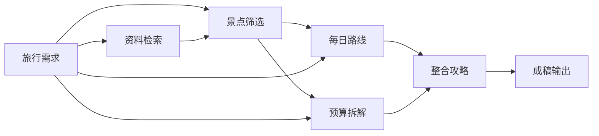
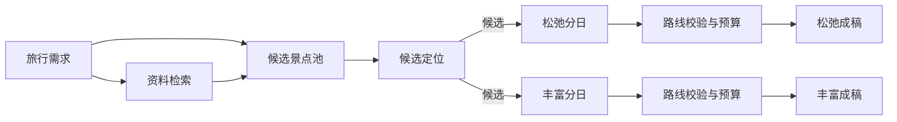

# 高级流程：从步骤观察到生成工程

## 产品判断

原来的四张固定流程卡片适合解释日常对话的状态，但不能表达用户自己的生成方法。新的高级入口是一份可编辑、可执行的生成工程：把一个大任务拆成几个边界明确的小任务，用连线声明数据依赖，查看每一步的产物，再决定修改和重跑哪里。

普通用户继续使用对话。高级用户可以从默认模板开始，逐步改提示词、增删步骤、分支尝试和汇合比较。两种模式在同一个旅行方案下提供入口；原固定图保留在“对话流程与单日优化”。

## 画布与节点

桌面采用工具箱、画布、节点参数与产物三栏。画布支持拖动节点、平移、缩放、聚焦节点、端口拖线或点击连接。手机与键盘用户可用节点选择器及连线列表完成同样的编辑。工程可保存、撤销、导入和导出 JSON；页签内未保存草稿可刷新恢复，跨窗口修订冲突保留本页内容。

| 节点 | 输入 | 输出 | 独立参数 |
| :--- | :--- | :--- | :--- |
| 文本输入 | 用户填写的需求、约束或自备文字 | 文本 | 正文 |
| 资料检索 | 一路或多路文本查询 | 带标题、摘要和原始链接的资料集合 | 补充检索词、结果条数 |
| AI 生成 | 多路文本、行程、预算及可选资料集合 | 生成正文及继承的资料来源 | 本步骤指令、温度 |
| 景点与日程 | 文本需求及可选资料集合 | 有明确每日地点、时间、费用口径和引用的行程数据 | 本步骤指令、温度 |
| 候选景点池 | 文本需求及可选资料集合 | 独立于日期的具体景点、理由、停留建议、费用口径与来源 | 本步骤指令、温度、候选上限 |
| 候选合并 | 1至8份候选景点池 | 去重候选、逐组取舍、分支原建议与合法引用 | 来源优先级、合并上限、冲突费用策略 |
| 候选定位 | 一份候选景点池 | 带逐项地图地点、备选、匹配状态和查询时间的候选池 | 指定地图候选或清除指定 |
| 分日分配 | 一份候选景点池 | 分日行程及已安排／排除／容量未容纳的逐项记录 | 时长／位置策略、天数、节奏、首站时刻、上限、必去／排除、默认停留与缓冲 |
| 景点筛选 | 一份已有每日安排 | 筛选后的行程及保留／移除／停留调整记录 | 每日上限、必去、排除、建议停留 |
| 路线校验 | 一份行程数据 | 地图定位、分段交通、顺序核对、建议排时和跨日检查后的行程 | 市内默认交通、沿用／减少折返 |
| 预算汇总 | 一份行程数据 | 全团预估、分类小计、未知项、缺项预留及相对预算差额 | 饮食人天、住宿房晚与房间数、往返人均、全团备用金 |
| 成稿输出 | 正文、行程、预算及可选资料集合 | 汇总文档、结构化数据及来源 | 节点名称 |

文本、资料、候选景点、行程和预算为五种端口类型，画布分别用绿色、黄色、紫色、蓝色和橙色表示。一个输出可以分发到多个节点；自由生成节点可汇合多路上下文，包括候选池摘要。候选合并的候选端口允许多输入，分日与候选定位一次只接收一份候选池，筛选、路线与预算工具一次只处理一份行程；成稿的行程和预算各限一份，汇合时检查预算是否来自同一份行程，不把另一套方案的数字直接拼入正文。候选端口不能直接冒充每日行程输出。

景点与日程节点使用模型生成结构，程序验证日期是否完整、地点是否具体、活动数量及引用范围，去除模型自报的人工费用标签和网址；不接受模型生成的坐标或实际记录。路线节点调用地图服务定位并检查交通，保留所有活动；未配置、歧义或服务失败时保留建议并显示未知。预算节点不调用模型，沿用正式路书的金额换算和费用分类；未知人数、费用口径及未列项目不当作零成本。

结构化数据可在侧栏展开每日地点、路段与费用明细，也可下载 JSON。自由生成节点可接收行程或预算的可读摘要进行改写、比较；需要再次输出结构时，可将正文连接到景点与日程节点。

工程不接受自定义脚本、任意 HTTP 执行器或文件命令。导入的 JSON 按同一份节点契约校验。

## 八套默认模板

1. **城市灵感**：旅行需求 → 资料检索 → 城市推荐与取舍 → 提案。
2. **完整行程**：需求与资料 → 景点筛选；分支生成每日路线和预算；再汇合为完整攻略 → 成稿。
3. **双方案比较**：同一份需求和资料分别连接松弛版、丰富版；两份产物汇入比较节点 → 决策书。
4. **结构化行程**：需求与检索资料 → 景点与日程数据 → 地图路线校验 → 程序预算汇总；路线与预算汇入结构化成稿。
5. **筛选与优化**：在结构化行程中加入景点筛选，再进行减少折返和交通核验；默认每日最多三处景点，加载后可自由调整规则和连线。
6. **候选池分日规划**：需求与资料 → 独立候选景点池 → 程序分日 → 路线校验与预算 → 可核对采用的成稿。可从同一候选端口分出多种天数和节奏，不必重新生成景点。
7. **按区域分日规划**：候选池 → 独立定位 → 按位置分组 → 路线与预算核验 → 成稿。定位供多个分支复用，未明确定位时沿用时长方案。
8. **多主题汇合规划**：共同需求与资料分别生成“人文候选”“户外候选” → 程序候选合并 → 定位分日与路线预算 → 成稿。默认冲突费用未知，完整分支建议可回查。

模板使用相同的节点、端口和执行引擎。加载后可以自由删改，没有另一套隐藏执行顺序。当前旅行已有需求会作为可编辑初稿填入输入节点；账目、凭证、照片和回顾不自动作为生成输入。

## 独立候选池与分日

候选节点只生成地点与推荐理由，不生成日程、坐标、预约或实际记录。默认最多12处，可设置1至40处；按同名同城去重、保留首次资料，ID由程序生成；数字引用仅允许继承的检索编号，模型自报网址不成为来源。目的地尚未明确、没有候选或名称不具体时失败，下游不补造完整计划。

分日不调用模型，按候选顺序和必去优先，选择负担较小的可容纳日期。默认沿用需求天数，也可明确覆盖；松弛／均衡／丰富对应每天最多2／3／4处及4／6／8小时，数量上限可单独调整。首站默认09:00，未知停留默认90分钟，段间默认预留30分钟；均可配置，时间窗口不跨午夜。按停留与缓冲安排，不把缓冲写成已核实交通，默认按时长，另可接入定位按坐标分组；不保证最优装入或全程可达。

首版要求可用候选同城。必去与排除冲突、缺失必去、必去装不下、候选不足以覆盖每天或当前时间窗口不能形成完整天数时明确报错；修正规则可复用原候选。普通候选未排入的保留在池中，并在记录里解释排除或超出容量。分日只安排景点，餐饮、住宿和往返交通未自动加入时间轴；后续路线核验与预算预留仍有必要，营业及预约也需核对。

同一候选池可接多个分日分支；只改某分支参数时复用候选模型、检索及其他分支产物，保留原运行快照。候选与分日数据可直接核对和下载JSON，参数随个人模板跨旅行复用。纯结构化成稿继续走原有保护预览与新版本采用；有实际记录或人工约束时，天数等需求变化仍可能阻止采用，不能借分日覆盖原事实。

## 多路候选池合并

合并是确定性节点，不调用模型，一次接收1至8份同类候选池。没有明确优先级时按来源节点编号排序，可在界面上下移动；新建节点与模板默认最多40处，仍使用已有候选端口。旅行需求的已知目的地、出发地、天数、人数、日期、预算或口径不同会阻止合并，缺失值可沿用其他分支明确值，偏好取并集。

按同名同城，或近期明确的同一地图地点去重。不同明确地图编号、不同显式指定不被当作重复删除；同名候选分别保留并生成稳定且不冲突的ID。同一明确地点的别名可合并，未知身份不会跨城市合并。

名称、理由、停留和引用采用优先来源，不把另一分支的未知补全成新事实。默认将冲突费用设为未知，也可明确选择沿用优先来源；停留差异保留首选建议并列出其他分支原值。每组记录直接来源节点、候选原建议与引用，超过上限的也保留记录。各分支数字引用重新绑定到统一来源，只保留有效编号；研究资料仍受80条来源上限约束，缺失引用不会成为已核实依据。上游已合并的更早过程仍可在上游运行快照回查。

明确地图指定优先于同一地点的自动匹配，意图不因合并被丢掉；过期坐标不作为可用定位。定位节点默认继承上游指定并重新核验，用户可明确清除指定；清除标记不会又被上游覆盖。候选数据、取舍记录、来源优先级及策略进入JSON、模板和固定运行快照，正式采用继续使用原有记录保护。

合并只统一候选，不能替代分日、定位、真实交通或需求确认。当前高级工程在本轮汇合功能完成后收口，下一阶段转入 [全面前端升级](FRONTEND_UPGRADE_PLAN.md)，先处理反馈与交互，再与用户讨论整体视觉方向。

## 候选定位与区域分组

候选定位继续使用候选端口，不调用模型，只从高德服务接收地点和坐标。按名称、城市、地点类型匹配，地图城市不一致或不明确时不采用坐标；每项保留匹配状态、备选和查询时间，失败、未找到、歧义及未配置分开说明。每项与整批查询均有超时边界，未完成项不沿用旧坐标；不可用产物不进入可复用缓存，后续运行会重试。

同名地点可在本节点产物中指定地图候选，再运行应用。只接受本次查询结果中仍存在且同城的编号，过期指定不自动换到别处；需重新选择、清除指定或排除该候选后继续。个人模板保存指定编号，目标候选池没有对应候选时不应用，保存窗口说明复用边界。

按位置分组先形成符合停留、缓冲、必去与数量上限的时长方案，再对原入选集合进行有限跨日交换与日内顺序调整。只有入选地点全部具有24小时内的明确同城定位时才启用；其余情况沿用完整时长方案。保持每天非空、入选集合、数量和时长约束，只接受同日两两直线距离合计的严格改善，或更短的日内直线顺序；不保证全局最优，不把分散度当成实际交通里程。显示区域、前后分散度与降级原因，原候选和旧运行保持不变。

24小时内的明确定位供多分支、路线与纯结构化采用复用，不重复搜索已明确地点；路线重跑仍查询实际交通。刷新地点应强制重跑候选定位节点。用户指定的地点超过复用期限后，分日、路线及历史成稿采用要求重新定位，不能自动换成别处。定位不核实营业、预约或票价，正式采用继续恢复已有记录、校验路线并保存新版本。

## 景点筛选与路线参数

筛选只处理上游已有每日安排中的景点，不添加新地点或自动跨日搬移。必去／排除可按名称关键词匹配，支持换行、逗号或顿号分隔，最多20项；名单矛盾、找不到必去景点或筛成空白日时阻止下游，明确提示修正。普通景点按上游顺序取舍；必去和受保护景点优先，超过每日上限时仍完整保留并说明原因。可统一调整未受保护景点的建议停留时长。

住宿、餐饮、车站、已执行前段、预约和固定时刻不参与普通筛选。人工费用及铁路／航班／接驳的端点保持衔接；筛选或改序改变前后站时清空原路段的建议耗时、费用与引用，不能把旧交通套到新路线。保留仍有效的人工／已执行路段与明确交通资料，再由路线节点核验。

路线默认沿用上游顺序。启用“减少折返（确认坐标）”后，每日首站及固定项目切开区段，只重排其间的普通景点；没有确认坐标或跨城市的区段不做几何重排。只接受直线长度严格改善的建议，再重新查询实际分段交通；完整地图结果若显示用时增加，则保留上游顺序。未知交通不视为零，校验超时退回原顺序，不保留部分优化结果；算法不保证全局最短，也不验证营业和预约可用性。

产物可核对保留／移除理由、停留变化、原／现顺序、直线长度和完整地图耗时；JSON保留结构化记录。参数变化只使相关下游待更新，上游模型和检索可复用。个人模板会保存这些规则，跨城市使用前可在保存窗口核对必去／排除及路线设置。正式采用仍经过原有保护预览，不直接改写账目或历史。

## 分类预算预留

预算节点沿用上游人数，支持饮食按人天、住宿按房晚及明确房间数、往返大交通按人、备用金按全团整趟固定金额。所有参数默认留空，不内置未验证的当地价格；金额以整数分保存，计算不调用模型或生成实际消费。参数、逐项计算说明和未知金额进入模板、运行快照及 JSON 导出，改动只重算预算及其下游。

规则只补未列分类，不重释已有分项：某天已有饮食／住宿预算（含零元或待核实）时不再添加该天整类预留；未指定日期的同类项目会阻止推测逐日缺项。人数或房间数未知时保留未知，不当成零。住宿按旅行天数减一晚，默认末日不留宿；已有车站、交通活动、铁路／航班／接驳或自定义交通预算时不叠加整趟往返，缺少的单程需自行补充。每日部分餐费、夜间交通等情况仍需核对，本规则不证明覆盖全程费用或核实报价。

采用纯结构化成稿时，先恢复实际记录、关联站点和人工预算，再使用保存的规则重新判断缺项，不复制工程总数。确认后预留成为可编辑、可关联实付的自定义预算，后续采用保留现有金额；修改或删除在正式预算中进行。文字或混合成稿仍走原有提取流程，不隐式附加结构化预算规则。

## 个人命名模板与跨旅行复用

- “保存为我的模板”保存当前编辑中的节点、连线、布局、参数和指令，无需先保存当前工程，也不会附带来源旅行、运行产物、采用预览或正式旅程记录。未完成的工程也可保存，但结构与端口必须有效。
- 每个文本输入默认标为“载入时使用本次旅行需求”，保存时清空正文，载入时填入目标方案最新正式版本的需求；没有正式需求则留空。可取消勾选，将通用约束或自备资料作为固定文字保留。节点提示词、名称和检索设置仍会复用，保存窗口可核对这些内容，不能自动判定其中哪些个人信息应该保留。
- 模板库支持名称与说明搜索、编辑名称与说明、用当前工程更新、删除。载入先取得指定修订的模板，再成为目标旅行中可撤销的工程草稿；不会自动保存、运行或采用，也不会修改模板本身或其他已载入的工程。
- 创建、更新与删除支持最近请求重试；发生后续修改则拒绝旧请求。更新和删除比较修订号，旧窗口不能覆盖新内容；失败保留本页表单，用户可明确重新载入最新模板核对。删除清空模板正文并保留修订墓碑，旧保存请求不能复活内容；已载入的工程不受影响，删除来源旅行也不会删除独立模板。
- 当前是本机共享模板库，最多100个，名称忽略全半角、大小写及连续空白后不重复；修订号用于冲突保护，尚无个人模板历史回退、云同步或共享发布。工程 JSON 导入导出仍可用于手工备份。

## 运行与依赖

- 保存工程与执行工程是两件事：未填完的草稿可以保存，运行前检查所需输入、端口、缺失节点、重复连线和循环。
- “运行到此节点”只执行目标及必要上游；“运行全部”执行整个工程。分支表示独立的数据依赖，当前调度按拓扑顺序执行，不承诺并行外部调用。
- 每一步保存状态、实际耗时、产物与安全错误信息。一个分支失败时，独立分支仍可完成；依赖失败结果的下游显示阻塞。
- 根据节点参数、实际上游产物和对应服务配置判断缓存。相同输入且产物生成于24小时内可复用；移动节点不影响内容缓存。修改上游时在画布提示待更新，执行时再次计算真实依赖。
- 强制重跑目标节点可获得新的生成结果；必要上游仍可复用。停止或中断后保留已完成产物，下次运行继续判断可复用部分。
- 运行快照保存当时的整个工程，能只读回看参数与连线，并下载节点 Markdown。当前展示最近20次运行。

## 产物采用与边界

成稿采用已接入。只有已完成或缓存成功的成稿输出节点可整理预览，来源绑定所选运行、节点和固定产物；历史运行可以明确选用，当前工程另有修改不会替换其成稿。工程仍在运行时先完成或停止，再预览。

1. 纯结构化成稿直接沿用所选运行的数据，不再调用模型提取；正式正文从合并后的行程和费用重新生成，源成稿及其旧预算、筛选过程保留在运行快照。文字成稿仍由模型提取唯一明确的每日安排及需求；城市推荐、没有每日安排、多个未决备选不被补造为正式计划。混入自由正文的成稿走文字提取，避免正文与附带数据不一致。
2. 程序匹配既有站点并恢复保护记录：已执行前段、预约、固定时刻、人工费用、消费／照片关联、人工交通路段与旅中起点。保护站点按原日保留，非唯一匹配或保护次序冲突会阻止采用。
3. 校验路线、固定时刻与跨日衔接；展示需求前后、预算、每天时间轴、新增／移除／调整／保留项，以及现有账目和照片等保留说明。核对窗口独立于画布，支持桌面并排、手机纵向浏览。
4. 预览独立持久化；确认时重新核对正式版本、对话过程与来源。变化、待确认操作、结束状态或预览冲突会阻止采用。
5. 确认后写入同一方案的新正式版本和对话状态；新旧引用合并编号，后续对话、预算、回顾核对和导出沿用新状态。旧版本保持原样，同一请求重试复用结果。

没有原路书时可以创建首版。已有实际记录或人工约束时，不在采用过程中重释已明确的目的地、出发地、日期、人数、总天数和预算口径，需要先回原对话明确调整。原账目、回款、凭证、付款日、人工预算、回顾与照片继续保留，模型不接收这些私人记录；只发送原需求参考、所选成稿及其资料。

首批结构化工具节点、个人命名模板、每日景点筛选、路线顺序参数、分类预算预留、独立候选池与分日已完成。候选定位与区域分组已完成。多路候选池合并与去重已完成。下一阶段转入全面前端升级，先盘点和统一操作反馈，再与用户讨论视觉及布局；跨城和新增节点排在升级之后。

当前限制：最多20个节点、80条连线，单份结构化行程最多80个活动；生成节点共用系统配置的模型与检索服务，可单独设置指令和温度；预算只汇总已列项目与明确设置的缺项预留，未知分项及未覆盖费用仍另计，不推测人数、房间数或真实价格。地图结果不证明营业、预约或票价已核实。工程、运行及采用预览保存在本机 SQLite，未保存的页签草稿在会话存储中。路线及采用校验可能耗时，失败时可局部重跑；本轮验收使用隔离数据和服务替身，未重新实测真实模型和地图服务。
