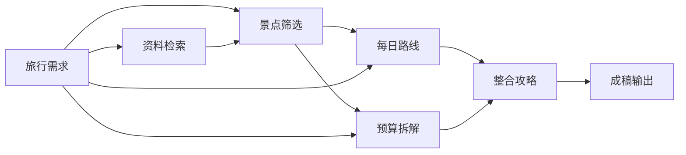

# 高级流程：从步骤观察到生成工程

## 产品判断

原来的四张固定流程卡片适合解释日常对话的状态，但不能表达用户自己的生成方法。新的高级入口是一份可编辑、可执行的生成工程：把一个大任务拆成几个边界明确的小任务，用连线声明数据依赖，查看每一步的产物，再决定修改和重跑哪里。

普通用户继续使用对话。高级用户可以从默认模板开始，逐步改提示词、增删步骤、分支尝试和汇合比较。两种模式在同一个旅行方案下提供入口；原固定图保留在“对话流程与单日优化”。

## 画布与节点

桌面采用工具箱、画布、节点参数与产物三栏。画布支持拖动节点、平移、缩放、聚焦节点、端口拖线或点击连接。手机与键盘用户可用节点选择器及连线列表完成同样的编辑。工程可保存、撤销、导入和导出 JSON；页签内未保存草稿可刷新恢复，跨窗口修订冲突保留本页内容。

| 节点 | 输入 | 输出 | 独立参数 |
| :--- | :--- | :--- | :--- |
| 文本输入 | 用户填写的需求、约束或自备文字 | 文本 | 正文 |
| 资料检索 | 一路或多路文本查询 | 带标题、摘要和原始链接的资料集合 | 补充检索词、结果条数 |
| AI 生成 | 多路文本、行程、预算及可选资料集合 | 生成正文及继承的资料来源 | 本步骤指令、温度 |
| 景点与日程 | 文本需求及可选资料集合 | 有明确每日地点、时间、费用口径和引用的行程数据 | 本步骤指令、温度 |
| 路线校验 | 一份行程数据 | 地图定位、分段交通、建议排时和跨日检查后的行程 | 市内默认交通 |
| 预算汇总 | 一份行程数据 | 全团预估、分类小计、未知项和相对预算差额 | 沿用上游人数与费用口径 |
| 成稿输出 | 正文、行程、预算及可选资料集合 | 汇总文档、结构化数据及来源 | 节点名称 |

文本、资料、行程和预算为四种端口类型，画布分别用绿色、黄色、蓝色和橙色表示。一个输出可以分发到多个节点；自由生成节点可汇合多路上下文。路线与预算工具一次只处理一份行程；成稿的行程和预算各限一份，汇合时检查预算是否来自同一份行程，不把另一套方案的数字直接拼入正文。

景点与日程节点使用模型生成结构，程序验证日期是否完整、地点是否具体、活动数量及引用范围，去除模型自报的人工费用标签和网址；不接受模型生成的坐标或实际记录。路线节点调用地图服务定位并检查交通，保留所有活动；未配置、歧义或服务失败时保留建议并显示未知。预算节点不调用模型，沿用正式路书的金额换算和费用分类；未知人数、费用口径及未列项目不当作零成本。

结构化数据可在侧栏展开每日地点、路段与费用明细，也可下载 JSON。自由生成节点可接收行程或预算的可读摘要进行改写、比较；需要再次输出结构时，可将正文连接到景点与日程节点。

工程不接受自定义脚本、任意 HTTP 执行器或文件命令。导入的 JSON 按同一份节点契约校验。

## 四套默认模板

1. **城市灵感**：旅行需求 → 资料检索 → 城市推荐与取舍 → 提案。
2. **完整行程**：需求与资料 → 景点筛选；分支生成每日路线和预算；再汇合为完整攻略 → 成稿。
3. **双方案比较**：同一份需求和资料分别连接松弛版、丰富版；两份产物汇入比较节点 → 决策书。
4. **结构化行程**：需求与检索资料 → 景点与日程数据 → 地图路线校验 → 程序预算汇总；路线与预算汇入结构化成稿。

模板使用相同的节点、端口和执行引擎。加载后可以自由删改，没有另一套隐藏执行顺序。当前旅行已有需求会作为可编辑初稿填入输入节点；账目、凭证、照片和回顾不自动作为生成输入。

## 个人命名模板与跨旅行复用

- “保存为我的模板”保存当前编辑中的节点、连线、布局、参数和指令，无需先保存当前工程，也不会附带来源旅行、运行产物、采用预览或正式旅程记录。未完成的工程也可保存，但结构与端口必须有效。
- 每个文本输入默认标为“载入时使用本次旅行需求”，保存时清空正文，载入时填入目标方案最新正式版本的需求；没有正式需求则留空。可取消勾选，将通用约束或自备资料作为固定文字保留。节点提示词、名称和检索设置仍会复用，保存窗口可核对这些内容，不能自动判定其中哪些个人信息应该保留。
- 模板库支持名称与说明搜索、编辑名称与说明、用当前工程更新、删除。载入先取得指定修订的模板，再成为目标旅行中可撤销的工程草稿；不会自动保存、运行或采用，也不会修改模板本身或其他已载入的工程。
- 创建、更新与删除支持最近请求重试；发生后续修改则拒绝旧请求。更新和删除比较修订号，旧窗口不能覆盖新内容；失败保留本页表单，用户可明确重新载入最新模板核对。删除清空模板正文并保留修订墓碑，旧保存请求不能复活内容；已载入的工程不受影响，删除来源旅行也不会删除独立模板。
- 当前是本机共享模板库，最多100个，名称忽略全半角、大小写及连续空白后不重复；修订号用于冲突保护，尚无个人模板历史回退、云同步或共享发布。工程 JSON 导入导出仍可用于手工备份。

## 运行与依赖

- 保存工程与执行工程是两件事：未填完的草稿可以保存，运行前检查所需输入、端口、缺失节点、重复连线和循环。
- “运行到此节点”只执行目标及必要上游；“运行全部”执行整个工程。分支表示独立的数据依赖，当前调度按拓扑顺序执行，不承诺并行外部调用。
- 每一步保存状态、实际耗时、产物与安全错误信息。一个分支失败时，独立分支仍可完成；依赖失败结果的下游显示阻塞。
- 根据节点参数、实际上游产物和对应服务配置判断缓存。相同输入且产物生成于24小时内可复用；移动节点不影响内容缓存。修改上游时在画布提示待更新，执行时再次计算真实依赖。
- 强制重跑目标节点可获得新的生成结果；必要上游仍可复用。停止或中断后保留已完成产物，下次运行继续判断可复用部分。
- 运行快照保存当时的整个工程，能只读回看参数与连线，并下载节点 Markdown。当前展示最近20次运行。

## 产物采用与边界

成稿采用已接入。只有已完成或缓存成功的成稿输出节点可整理预览，来源绑定所选运行、节点和固定产物；历史运行可以明确选用，当前工程另有修改不会替换其成稿。工程仍在运行时先完成或停止，再预览。

1. 纯结构化成稿直接沿用所选运行的数据，不再调用模型提取。文字成稿仍由模型提取唯一明确的每日安排及需求；城市推荐、没有每日安排、多个未决备选不被补造为正式计划。混入自由正文的成稿走文字提取，避免正文与附带数据不一致。
2. 程序匹配既有站点并恢复保护记录：已执行前段、预约、固定时刻、人工费用、消费／照片关联、人工交通路段与旅中起点。保护站点按原日保留，非唯一匹配或保护次序冲突会阻止采用。
3. 校验路线、固定时刻与跨日衔接；展示需求前后、预算、每天时间轴、新增／移除／调整／保留项，以及现有账目和照片等保留说明。核对窗口独立于画布，支持桌面并排、手机纵向浏览。
4. 预览独立持久化；确认时重新核对正式版本、对话过程与来源。变化、待确认操作、结束状态或预览冲突会阻止采用。
5. 确认后写入同一方案的新正式版本和对话状态；新旧引用合并编号，后续对话、预算、回顾核对和导出沿用新状态。旧版本保持原样，同一请求重试复用结果。

没有原路书时可以创建首版。已有实际记录或人工约束时，不在采用过程中重释已明确的目的地、出发地、日期、人数、总天数和预算口径，需要先回原对话明确调整。原账目、回款、凭证、付款日、人工预算、回顾与照片继续保留，模型不接收这些私人记录；只发送原需求参考、所选成稿及其资料。

首批结构化工具节点与个人命名模板已完成。下一步逐步拆分景点候选筛选、路线优化及费用估算参数；按需求扩展模型选择和调度优化。

当前限制：最多20个节点、80条连线，单份结构化行程最多80个活动；生成节点共用系统配置的模型与检索服务，可单独设置指令和温度；预算只汇总已列项目，尚不自动补齐遗漏的餐饮、住宿、往返交通或备用金。地图结果不证明营业、预约或票价已核实。工程、运行及采用预览保存在本机 SQLite，未保存的页签草稿在会话存储中。路线及采用校验可能耗时，失败时可局部重跑；本轮验收使用隔离数据和服务替身，未重新实测真实模型和地图服务。
