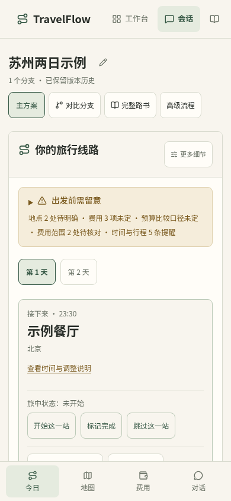

# 手机端现状与设计评审说明

核对日期：2026-11-05。面向项目所有者与后续开发者，说明当前实现、设计理由与待评审问题；日常操作见[用户指南](../user-guide.md#手机浏览器使用)。本页不是新设计方案，也不代表用户已验收手机端。

## 设计归属与确认边界

用户本次明确说明：手机端基本由AI主持开发，自己此前投入精力有限，现在开始重点审视。过去文档把M1、共享样式选型和具体手机实现连写为“已确认”，容易扩大确认范围，后续应按以下边界理解。

| 类型 | 当前解释 |
| --- | --- |
| 历史文档中的方向记录 | 曾记录电脑规划、手机旅中，以及M1今日路线的布局标签；保留历史，不据此推定用户设计了全部手机细节。 |
| AI主导的具体实现 | 四项底部快捷导航、单页滚动定位、当前站选择、折叠层级、按钮位置、900px断点及高级工程适配等，均应作为已有实现供用户评审。 |
| 工程验证 | 窄屏浏览器自动化、截图、接口和幂等验证，证明相应测试条件下行为通过。 |
| 用户认可与实地体验 | 具体交互是否顺手、旅途中是否足够快，仍需用户真实使用与判断；自动回归不等于用户验收。 |

此次只补说明与纠正确认边界。现有实现保留，新的手机交互取舍需结合用户反馈决定，不把文档补齐当作设计定稿。

## 手机端是什么，以及数据在哪里

当前是同一Next.js网站的响应式界面，不是独立Android／iOS应用。旅行工作区在视口宽度不超过900px时采用单列与底部导航；其他页面按各自响应式规则适配，不能理解为全站只有一个统一断点。

手机访问同一个服务、会话和分支时，读写同一份后端旅程与版本，不复制一份“手机版行程”。数据保存在运行后端的机器上，手机浏览器只是访问入口；主题等浏览器本地状态不应假定会跨设备同步。

项目默认按本机自托管使用。手机里的localhost指向手机自身，不能用电脑的localhost地址直接连接电脑服务。电脑是否持续运行、网络是否可达、安全访问方式，都属于真机使用的前置条件。尚未提供经验证的异地远程访问、账户隔离、云同步或离线编辑闭环；不要把界面适配理解为出门后天然可用。离线可阅读已导出的文件，不代表离线可继续修改、导航或记账。

## 先看一张已有正式界面截图

这是仓库已有的发布示例图，使用虚构数据，不是本轮新增真机截图。它反映今日路线的内容层次；其他状态和历史原图见[普通主流程截图](../internal/ordinary-flow/README.md)、[三主题截图](themes/README.md)。

## 当前页面结构与操作方式

旅行工作区地址为 `/chat/{sessionId}`，可通过 `?branch={branchId}` 指定方案。全站顶部导航用于工作台、会话、回顾、生涯、比较与设置；底部四入口只服务于当前旅行，并不是全站导航。点击这四项不会创建四个独立路由的历史记录，不能把浏览器返回键理解为栏目之间逐级返回。

| 当前区域 | 已实现行为 | 设计理由与实际代价 |
| --- | --- | --- |
| 未生成行程 | 先展示对话和已知条件，地图／费用等没有数据的入口禁用 | 避免让首次用户面对空的今日页；城市候选目前仍需手输序号或名称。 |
| 已有行程 | 手机将路线排在对话前面，保留全部内容；必要信息缺失或路书加载失败有对应提示与重试 | 旅中先看路线；生成后的对话在页面更下方，依赖快捷入口到达。 |
| 底部“今日／地图／费用／对话” | 在同一页面滚动到目标并聚焦；不会切换成四套独立页面或卸载表单。点对话会聚焦输入框 | 保留输入与费用草稿、共用同一旅程；长页面仍存在，当前高亮主要由点击状态决定，不能当作完整的滚动位置指示器。 |
| 顶部方案工具 | 可切换方案、查看版本、比较、展开完整路书、进入高级流程；窄屏工具行允许横向滚动 | 保留维护能力；可发现性与误触风险仍需实际评审，横向可滚动控件不等于页面横向溢出。 |
| 集中核对区 | 展示地点、费用、覆盖缺项及时间提醒，并可定位相应处理入口 | 不编造完整性；真实样例19条提醒中13条通用接驳说明，重要冲突可能被淹没，尚未完成提醒分级改造。 |
| 日期与当前站 | 手动选择第几天、站点，展开路线和详细信息，标记开始／完成／跳过 | 当前站以用户记录为依据；不是GPS追踪或自动签到。 |
| 费用与账本 | 编辑预估、补实付、退款／报销、凭证，以及付款日与关联行程日 | 与桌面同一预算和账目；表单较多，手机上不是单个金额输入框即可完成所有情形。 |
| 结束与回顾 | 位于行程面板后部，可结束／重新开启、编辑回顾、选照片与导出 | 共享完整闭环，但通常要滚过路线和费用；底部四入口没有专门的回顾项。 |

## “今日”和“当前站”如何确定

初次选择行程日时，有合法出发日期且浏览器当前日历日期落在行程内，则选择对应第N天；否则回到第一天。这里没有按旅行所在地时区自动跟随，也不是根据消费付款日推断。用户可以手动换天，不能把“今日”文案当作实时行程判断。

当前站默认优先取正在进行的非定位起点活动，再取未开始活动；都没有时回看第一个非定位起点活动。用户点选具体站后显示该站。时间和进度来自计划、用户标记与旅中调整，不会因到了某个坐标就自动完成活动。

## 地图、导航、网络与定位

- 页面地图展示高德静态地图和已查询的路线结果，未定位地点／未知交通保留提示，不等同于持续导航。
- “打开地点导航”跳到高德链接，默认使用当天上一站的已确认地点作为起点；是否唤起手机上的高德App由设备与浏览器决定，尚未逐机验证。
- 用户主动点定位才请求浏览器位置，再由后端转换坐标。浏览器定位要求安全上下文（HTTPS或本机localhost）；手机通过电脑局域网HTTP地址访问时通常不满足此条件，不能承诺可定位。
- 定位拒绝、超时或不可用时保留原记录，可在高德页面手动选择起点；没有持续后台定位或自动位置记录。
- 模型、检索、地图查询和服务端读写依赖相应服务可达。已有导出可带走，但当前没有手机断网离线写入后自动合并的能力。

## 其他页面在手机上的情况

会话、新建、设置和偏好使用单列布局与可换行字段；比较页纵向阅读方案；回顾列表与生涯支持回到来源分支。照片缩略图固定尺寸，展开保持原比例，缺图回落文字。它们仍是网站页面，不具有原生App的返回、系统分享或相册行为保证。

高级流程保留画布、工具箱、检查区直达与替代连接操作，并非专门重做的手机流程编辑器。节点拖动、缩放、长表单和多层产物的可用性仍需要实际体验；不能因390px下不溢出，就认定适合旅途中单手编辑复杂工程。

## 已有工程约束与验证边界

共享规范要求正文／输入可读、粗指针控件至少44px命中区；旅行底部入口最小高度54px，并给底部安全区留白，页面预留底栏空间。使用动态视口单位与减少动画规则。这些是实现规则，不是所有实际控件均已逐一真机测量的承诺。

主要自动化使用Chromium的390×844视口、触屏与mobile参数；也保留Windows Edge窄视口原图。2026-11-05新生产构建的26项桌面／手机相关回归通过，详见[现状](../internal/PROJECT_STATUS.md)。本轮补文档未新增运行这些测试，不把该结果重新计算为新验证。

| 已有覆盖或证据 | 仍未充分验证 |
| --- | --- |
| 路线优先、快捷导航保留草稿、无行程时对话优先、图片尺寸、主题与基本横向溢出 | iOS Safari／Android Chrome真机差异、软键盘弹出与输入法、地址栏伸缩、刘海与系统手势区域 |
| 正常与故障旅程、刷新恢复、分支隔离、记账、结束与导出 | 弱网长时间使用、切后台／锁屏、跨设备草稿、相机／文件选择及下载在各设备的表现 |
| 定位拒绝／失败的界面回退与明确地图结果 | 真机权限弹窗、高德App唤起、HTTPS访问、旅途中持续连通与电量消耗 |

## 需要用户重点评审的取舍

以下均未作为新方案批准：

1. 主要使用场景：手机是在电脑规划后执行，还是也要承担完整规划？这决定首屏与对话的重要程度。
2. 首屏内容：当前站、当天路线、地图和待处理冲突，哪一个应最先看见？现有M1仅是实现起点。
3. 操作组织：是否接受四个滚动快捷入口？结束／回顾是否应有就近入口？先评估实际使用，不预先增加第五项。
4. 真实使用的连接方式：旅途中如何安全访问自己的服务，是否需要离线可用或跨设备能力？这涉及数据与安全方案，不能只调整CSS解决。
5. 设计复杂度：手机是否只执行和记账，高级工程留给电脑；或者需要完整编辑？决定后再明确手机的最小必要能力。

建议阅读顺序：先看截图与页面结构，再用下面路径体验，记录“找不到／点不准／必须滚很多／以为会自动完成”的具体位置，最后决定上述取舍。文档补齐不直接启动手机重设计。

## 可重复的审视路径与源码入口

在[隔离验收环境](../internal/handoff/DEVELOPMENT.md#接手后的最短验收路径)使用虚构旅行，勿以真实个人记录做破坏性实验。桌面浏览器先以390×844查看已有流程；真机测试另需确认安全可达的服务地址。

按“无行程时补需求→选城市→生成→查看今日与待核对事项→换天／选站→导航→补一笔实付→回到对话调整→结束／回顾导出”顺序体验。重点看入口能否找到、往返是否丢草稿、未知是否被误认为已确认；故障测试使用已有隔离测试，不手动断开正常个人服务。

| 实现／验证职责 | 文件 |
| --- | --- |
| 页面顺序、四入口与对话聚焦 | [聊天页](../../frontend/app/chat/[sessionId]/page.tsx)、[journey.css](../../frontend/styles/journey.css) |
| 初始行程日、当前站优先规则 | [journey-view.ts](../../frontend/lib/journey-view.ts)、[行程面板](../../frontend/components/itinerary-panel.tsx) |
| 导航与定位回退 | [place-navigation.tsx](../../frontend/components/place-navigation.tsx) |
| 全站导航与通用触屏规则 | [app-shell.tsx](../../frontend/components/app-shell.tsx)、[components.css](../../frontend/styles/components.css) |
| 工作区移动适配回归 | [journey-workspace.spec.ts](../../frontend/tests/e2e/journey-workspace.spec.ts) |
| 完整正常／故障旅程 | [complete-journey.spec.ts](../../frontend/tests/e2e/complete-journey.spec.ts)、[测试配置](../../frontend/playwright.config.ts) |

界面行为改变时同步本页相关段落；产品取舍写入设计约定，任务状态写入路线图，验证结果写入现状或已有专题记录，避免这里再维护一份进度表。
