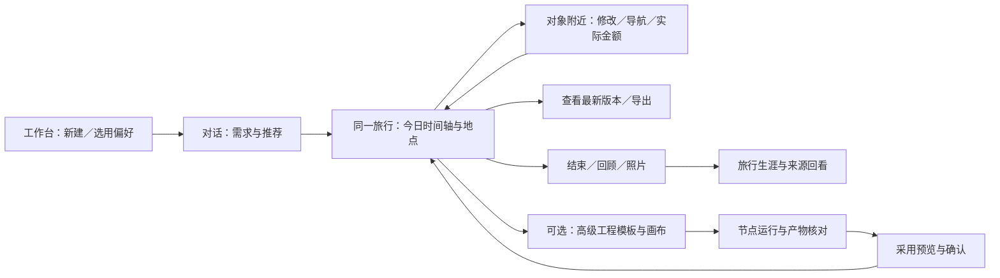

# FE-0 前端现状盘点

盘点日期：2026-10-26。应用基线：`640f15032fc83ea11ed355c9c0debcd3d10f6aed`。

**盘点完成，尚未实施 FE-1 或视觉改版。** 当前主要问题是操作状态、失败恢复和结果位置不一致，以及桌面布局直接压入手机。已有的原位记账、工程运行状态、预览采用和部分失败恢复应当保留。建议先修复下面的 P1，再讨论整体视觉与工作台布局。

## 范围与证据

- 源码扫描覆盖 `frontend/app`、`frontend/components` 的 41 个 TSX 文件，记录 **367 处控件定义**，位于 39 个文件；包括按钮、链接、表单、输入、展开和自定义点击入口。循环定义只计一次，共享组件实现也计入，**不是 367 个不同按钮，更不是 367 个缺陷**。
- 11 类路由均取得桌面 1440×1000、手机 390×844 基线截图；加上空、错、提交中及局部操作状态，共 **76 张视口截图**，附尺寸、状态及位置 JSON。
- 10 组浏览器探测 × 两种视口，共 **20 项通过**。探测记录当前行为，包括缺陷；通过表示复现和取证完成，不表示界面没有问题。
- 使用现有隔离浏览器服务、临时 SQLite 和固定模型／检索替身，未读取真实 `.env`、个人旅行库或调用外部服务。配置正常状态仅修改测试响应中的 `ready`；剪贴板成功使用浏览器替身。
- 产物：[操作入口 CSV](action-inventory.csv)、[扫描统计](inventory-summary.json)、[逐区域交互审查](interaction-review.md)、[截图索引](screenshots.md)。截图与相邻同名 JSON 一一对应。

截图是布局与状态的证据，不是新视觉方案。对话基线通过测试夹具载入既有行程，没有构造历史聊天消息；地图未配置、地点参考图占位不作为真实地图故障证据。手机截图为 Chromium 触屏模拟，非真机验收；测试环境的表情字体缺字不列为产品缺陷。

## 优先修复：已复现

P1：影响继续操作、输入保留、错误判断或基本可用性，先于视觉重写。P2：仍可操作但发现、阅读或辅助操作成本明显，纳入对应阶段。

| 编号／优先级 | 触发与实际结果 | 用户影响 | 源码与证据 | 建议归属／验收 |
| --- | --- | --- | --- | --- |
| F01 / P1 | 首页配置响应中模型、检索均 `ready=true` 时，“新旅行偏好”区域数量为 0；改为未配置后为 1 | 正常配置的用户找不到勾选常用偏好的入口 | [首页](../../frontend/app/page.tsx#L63)，[正常配置](desktop/home-configured.json)、[未配置](desktop/home-unconfigured.json)；两端一致 | FE-1：偏好入口独立于配置告警；正常配置、未配置、加载失败都能继续创建旅行 |
| F02 / P1 | 分支对比初次请求会话返回 503，显示“还没有可对比的旅行”，无错误及重试入口 | 把服务失败误认为没有数据 | [对比页](../../frontend/app/compare/page.tsx#L27)，[失败截图](desktop/compare-failed.png)、[状态 JSON](desktop/compare-failed.json) | FE-1：失败、加载、真正为空分别呈现；原页可重试 |
| F03 / P1 | 会话改名提交前就关闭编辑框；返回 503 后再次编辑，只剩旧标题 | 新输入丢失，必须重填；提交中看起来没有发生操作 | [会话管理](../../frontend/app/sessions/page.tsx#L51)，[待提交](desktop/rename-pending.png)、[失败恢复值](desktop/rename-failed.json) | FE-1：保留编辑草稿，原位等待／错误／重试；成功确认后结束编辑。对话页标题编辑也需同类检查 |
| F04 / P1 | 归档请求暂不返回时，按钮仍可点击且文案不变；连续点击发送 2 次 PATCH | 等待期间无法判断进度，容易重复操作；未发现数据损坏 | [会话管理](../../frontend/app/sessions/page.tsx#L41)，[待提交证据](desktop/archive-pending.json)；手机同样为 2 次 | FE-1：按操作对象锁定提交，原位显示进行状态；失败恢复入口，成功更新行状态。删除、恢复、设为当前一起梳理，不假定均已实测 |
| F05 / P1 | 节点产物点击“复制正文”确实更新成功状态，但状态在屏幕上方；桌面 top=-613px，手机 top=-2035px | 用户在点击处看不到成功，容易再次点击或以为失效 | [工程顶部状态](../../frontend/components/workflow-studio.tsx#L497)、[复制入口](../../frontend/components/workflow-studio.tsx#L1189)，[桌面位置](desktop/studio-copy.json)、[手机截图](mobile/studio-copy.png) | FE-1：复制结果靠近入口，错误提供下载／手选替代；读屏可获知，不强制滚走 |
| F06 / P1 | 手机会话表格仍分四列，旅行名、更新时间、打开／重命名按钮挤为竖排 | 基本旅行入口难以辨认和点击；没有页面横向溢出也不代表可用 | [表格](../../frontend/app/sessions/page.tsx#L139)，[手机截图](mobile/sessions.png) | FE-1 先保证可用；FE-2/4 再统一列表：手机能自然阅读标题，操作不逐字折行 |
| F07 / P2 | 手机分支对比仍按方案数强制并列，两个方案已各占约半屏；标题与正文频繁换行 | 长路书难以阅读和比较 | [固定列数](../../frontend/app/compare/page.tsx#L202)，[手机截图](mobile/compare.png) | FE-2/4：评审手机切换／纵向比较方式，三方案也应能阅读 |
| F08 / P2 | 手机顶栏可用宽 212px、内容宽 640px，后面的设置／帮助等需横滑寻找；11 类路由均无 `aria-current`，对话／工程无匹配高亮项 | 用户不易发现导航或判断当前位置 | [全局导航](../../frontend/components/app-shell.tsx#L55)，[手机测量](mobile/home.json)、[工程基线](mobile/workflow.png) | FE-1 补当前位置语义；FE-2 决定手机导航及旅行上下文。横滑本身不定为错误，隐藏成本需解决 |
| F09 / P2 | 首页旅行卡片点击区为 `div`，无链接／按钮语义，tabIndex=-1；会话删除图标按钮没有名称 | 键盘和读屏无法可靠识别关键入口 | [首页入口](../../frontend/app/page.tsx#L134)、[删除入口](../../frontend/app/sessions/page.tsx#L209)，[DOM 取证](desktop/home-keyboard.json) | FE-1：语义入口、明确名称、焦点与键盘操作；不靠添加 `onKeyDown` 给普通容器补丁式模拟链接 |
| F10 / P2 | 对话重命名入口约 14×14px；工程放大／缩小按钮高约 16px，部分文本操作也仅 16px | 触屏容易误触，控制密度不统一 | [对话测量](mobile/chat.json)、[工程测量](mobile/workflow.json) | FE-1 先扩大关键命中区；FE-2 建立统一尺寸规则。尺寸是内部评审依据，本报告不宣称完成可访问性认证 |

F01—F05 为交互层优先项，F06 是本轮发现的基本手机可用性问题。其余按 FE-1 基础与 FE-2 布局范围分配，不因优先级较低而丢掉。

## 源码审查发现：尚未完整复现

这些项目与上表分开，不能写成“所有操作都已经失败”。

| 编号 | 审查事实／风险 | 后续验证与归属 |
| --- | --- | --- |
| R01 | [共享 Button](../../frontend/components/ui.tsx#L42)有加载图标与禁用，未自动设置 `aria-busy`；[设置保存结果](../../frontend/app/settings/page.tsx#L181)在顶部普通容器。各组件的成功、失败及忙碌语义不统一 | FE-1：统一可见文案和状态语义；延迟保存并从按钮位置检查提示，不能仅统计 `loading` 属性 |
| R02 | [工程导出](../../frontend/components/workflow-studio.tsx#L393)调用下载工具，没有对应原位“已发起”回执；JSON 导入成功通过画布变化表达，未明确宣布载入结果 | FE-1：浏览器下载事件和导入成功／失败验证；回执只说明发起，不承诺文件已落盘 |
| R03 | [对比页加载分支](../../frontend/app/compare/page.tsx#L42)缺少过期响应隔离，`setPrimary` 缺少进行状态；旧错误也未在该请求开始时清理 | FE-1：延迟后切换旅行、连点设为当前、重试成功后的状态验证。当前只做源码判断，未宣称已发生错误归属 |
| R04 | [通用请求](../../frontend/lib/api.ts#L77)封装自身未提供超时／取消；个别地图请求已有 AbortController，不能推广为全站没有取消 | FE-1：按长任务／普通保存分别定义等待、停止、回复丢失与重试；沿用已有幂等保护 |
| R05 | [减少动画规则](../../frontend/app/globals.css#L164)已覆盖 `animate-fade-up`；共享加载图标和显式平滑滚动仍需核对 | FE-1：系统减少动画、键盘焦点和屏幕阅读器实测；不重复建设已有规则 |
| R06 | 照片、票据、节点参数、账本等具有大量独立状态，已有保护与回执的实现分散，视觉与信息密度不同 | FE-1 统一状态契约，FE-3/4 再统一呈现。上传部分成功、断网、冲突、取消、回复丢失需针对关键路径复验 |

## 现有体验中应该保留的部分

| 区域 | 已确认的基础 | 改版时的保护要求 |
| --- | --- | --- |
| 预算与记账 | 实际金额编辑器出现在点击的条目内；模拟 503 后 `28.50` 仍保留。预算、实付和差额已有汇总 | [原位编辑](mobile/budget.png)、[失败保留](mobile/budget-failed.json)。不要退回到底部另填，也不要把估算当实际消费 |
| 常用偏好 | 提交期间按钮禁用；失败后两行输入完整保留，错误可见 | [等待状态](desktop/preferences-pending.json)、[失败保留](mobile/preferences-save-failed.json)。修复首页入口即可，不重造偏好模型 |
| 高级工程 | 运行期间已有“工程运行中…”、停止入口与禁用状态；工程还有待保存／缓存／运行记录等状态 | [延迟运行](desktop/studio-run-pending.png)。统一各操作结果位置，保留节点自由度、快照和受保护采用 |
| 回顾／生涯／部分加载页 | 回顾与生涯失败保留明确错误和重试；列表、阅读页与原行程跳转有区分 | [生涯失败](mobile/career-failed.png)、[回顾失败](mobile/recaps-failed.png)、[只读回顾](mobile/recap-detail.png)。别以失败时的零统计掩盖加载失败 |
| 导航、附件与草稿 | 源码已有上一站导航起点、定位失败替代提示、票据本机保存说明、回顾复制替代、聊天草稿及回复丢失重试 | 本轮未重新跑全部业务分支；FE-1/3 改动相关区域时继续使用既有回归，不能删除这些能力 |

## 页面覆盖与信息层级判断

每行都有桌面和手机截图；[完整索引](screenshots.md)列出全部状态，基线路由数量为 11。

| 路由 | 主操作与结果位置 | 盘点判断／进入阶段 |
| --- | --- | --- |
| `/` | 新建→对话；最近旅行→原会话；常用偏好 | F01/F09 先修；配置告警和主任务层级 FE-2 统一 |
| `/sessions` | 搜索、改名、归档／恢复、删除→原列表 | F03/F04/F06/F09；行级反馈、草稿与手机版列表优先 |
| `/chat/[sessionId]` | 对话修改→同一行程；日切换、地点、导航、预算、记账、回顾→右侧或下方 | 手机上聊天、旅程介绍、回顾、时间轴、账目纵向很长；当前旅行中应突出“今天／当前站”，结束与回顾入口的层级交 FE-2/3 评审 |
| `/workflow/[sessionId]` | 模板→画布→节点参数／产物→预览→采用正式版本 | F05/F10；介绍、个人模板和默认模板占据长页面，运行与检查的上下文需要连贯，FE-2/3 评审；普通用户不被迫进入工程 |
| `/settings` | 获取模型、连接测试、保存→各区测试结果及顶部保存提示 | 已有加载／禁用；R01/R04 的可见反馈与恢复先统一，视觉 FE-4 |
| `/preferences` | 编辑／保存／删除→已保存摘要及状态区域 | 失败保留已取证；首页入口修复后维持明确选用，FE-4 统一 |
| `/career` | 城市／分页→来源旅行、照片与足迹；返回对应旅程 | 已有来源口径与失败重试；统计说明较长，FE-4 评审折叠层级，不隐藏必要金额口径 |
| `/recaps` | 搜索／分页→回顾卡片；阅读／补记→固定版本／原方案 | 手机卡片基本可读；FE-4 统一导航与列表状态 |
| `/recaps/[versionId]` | 阅读、照片、返回来源、导出 | 只读边界明确；FE-4 保留版本来源与导出真实性 |
| `/compare` | 选择旅行／方案、设为当前→对比列及当前标记 | F02/F07/R03；先修加载与操作状态，再评审手机比较方式 |
| `/help` | 步骤、问答展开、外链 | 手机问答可读；FE-4 统一帮助入口，文档与界面更新同步 |

截图没有发现整页横向溢出；这不抵消 F06/F07 的挤压问题，也不代表覆盖了所有长文本、附件或运行产物布局。

## 核心任务路径与反馈位置



这是现有能力的任务路径梳理，不是新的信息架构或视觉方案。普通用户应围绕同一份行程完成修改和记账；工程是可选分支，采用后返回同一旅行。

| 路径 | 当前主要断点 | 下一阶段验收 |
| --- | --- | --- |
| 新建→恢复旅行 | 配置正常时偏好入口消失；最近旅行卡片无键盘入口 | 选择偏好、新建与重新进入的状态清楚，两种视口都可操作 |
| 修改→失败→继续 | 会话标题草稿丢失；预算草稿能保留 | 原入口呈现进行／失败，保留输入、焦点、操作对象；成功才更新已保存状态 |
| 记账→最新行程→导出 | 已有原位金额与统一版本，需要保持；导出回执不一致 | 不重复记账、不丢实际记录；当前版本和已发起下载可核对 |
| 模板→改节点→运行→采用 | 运行状态已有，产物复制反馈远离入口；长页上下文切换多 | 原位回执、等待／停止／失败恢复，快照与采用保护继续有效 |
| 结束→回顾→生涯 | 能闭环，旅中页面提前出现大量回顾内容 | FE-2 再定层级；未结束／未完成／未结算不被界面混为一谈 |

## FE-1 的建议交付顺序

1. **入口与失败恢复**：F01/F02/F03；把空／加载／失败与编辑／提交中／成功明确区分，修复确定性入口问题。
2. **操作反馈基础**：F04/F05/R01/R02；统一请求状态契约，结果靠近操作对象，等待时避免重复提交，复制／导入／导出反馈可核对；沿用业务请求标识，避免加提示时破坏幂等。
3. **基本手机与辅助操作**：F06/F09/F10，以及 F08 的当前位置语义；先解决能否读、能否点、能否继续，不预先决定品牌视觉。
4. **复验长任务与恢复边界**：R03—R06；覆盖延迟、断网、鉴权失败、冲突、停止与回复丢失；新增针对修复的回归，再跑相关既有业务测试。

完成后进入 FE-2，和用户讨论普通旅行工作台、手机版导航、流程画布、信息密度与整体风格，再实施 FE-3/4。F07、旅中回顾层级、模板库与画布关系归入这次方案评审。

## 未验证与复验方式

本轮没有重新验证全部 170 个既有业务浏览器场景，没有宣称完成真实模型质量、搜索／高德可用性、操作系统文件保存、真实剪贴板权限、真机定位、屏幕阅读器、照片批量上传失败、所有并发冲突／取消／回复丢失组合的验收。地图与图片问题需在后续相关阶段以脱敏的真实服务状态单独核对，不能从隔离占位图推断密钥或服务异常。

源码清单可重复生成：

```sh
cd frontend
node scripts/audit-frontend.mjs
```

浏览器探测使用已安装的 Chromium 与已有生产构建；修改应用后先构建。**配置会启动并停止隔离服务，请勿指向个人开发服务。** 每项探测串行清理的是测试服务的临时会话，再创建所需夹具。

```sh
cd frontend
pnpm build
pnpm exec playwright test --config=playwright.audit.config.ts
```

本次实际使用 `PLAYWRIGHT_BROWSERS_PATH=/tmp/travelflow-browser`，20 项通过；新增脚本与探测的 ESLint、全前端 TypeScript 检查通过。应用代码未修改，因此复用应用基线生产构建，未以重新跑全业务测试制造“改版已经完成”的印象。探测固定截图并写入同名 JSON，重新运行会覆盖本目录的观测；FE-1 修复后将相关缺陷转为修复断言，不维持错误行为。
