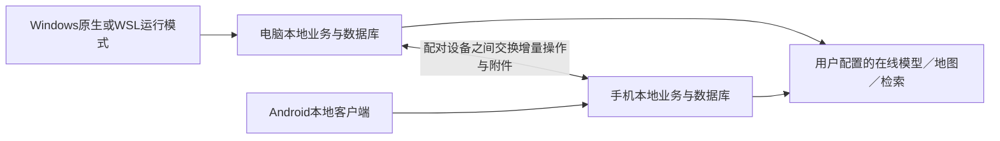

# 下一里程碑：双端本地运行与可靠同步

日期：2026-11-05。依据用户实际反馈和本轮澄清制定。本页是里程碑目标、阶段与验收的权威位置；路线图只维护入口，现状页记录实际实现与证据。当前P0已开始，本地接口基线与静态打包边界已复现；Android及连接原型未完成，正式业务改造未开始；框架与连接工具是待验证建议，不是已批准依赖。未部署、采购、迁移或升级应用架构。

## 1. 已确定的目标与范围

| 用户已明确的决定 | 本里程碑必须满足 |
| --- | --- |
| 不考虑常驻应用服务器 | 不要求租服务器、托管TravelFlow后端或保持个人电脑开机。 |
| 手机与电脑均可独立运行 | 手机关闭电脑后仍可打开应用并完整读写本地旅行；电脑无需连接手机才能工作。 |
| 完全断网时本地读写完整可用 | 查看、手动编辑、执行进度、预算、消费、退款／报销、已下载附件与已有回顾不以网络为前提；新AI、地图查询与网页检索需要联网。不能将本地能力偷偷缩为只读行程。 |
| 手机有网时独立使用AI／地图／检索 | 不通过电脑代理才能使用；电脑关机不影响手机调用自己配置且可达的服务。 |
| 同时在线直接同步必做 | 复用成熟连接技术，验证同局域网和异地网络；不是只交付手动导出／导入。 |
| 云端存储后续再考虑 | 本里程碑不把云盘／对象存储作为依赖，也不实现异步云端收发箱。 |
| 面向开源用户的跨端兼容 | 不把某个人的机型／路径／网络当作支持边界。当前先交付单所有者的跨设备运行；兼容性扩展不自动等于多人账号或SaaS，设备配对与本地身份仍必做。 |
| 手机为Android，电脑支持Windows和WSL中的Linux | Android独立安装入口；Windows原生运行与WSL运行均有可用路径，不能强制用户改操作系统或每次输入命令。 |

核心闭环：**电脑规划→手机本地执行和记账（电脑可关机）→双方运行并连接后同步→两端继续使用同一份旅行**。响应快、免终端、数据不丢不重是同时成立的完成条件。

边界：完全无网无法调用远程模型／高德／网页检索；两个设备未同时运行或网络不可达时无法即时交换，但各自仍可本地工作。界面明确显示待同步，而不是声称已到达另一台设备。Android后台被系统暂停时不承诺持续执行，回到前台要自动恢复。

## 2. 用户问题与当前事实

| 问题 | 代码已核对的事实 | 尚待测量／复现 |
| --- | --- | --- |
| 每一步慢 | 当前依赖前端代理和Python服务；普通保存也会更新图状态、路书投影和业务版本。代理超时240秒，模型默认90秒并有重试，部分地图链路有顺序依赖 | 网络、开发模式、数据库、序列化、路书投影、前端重复读取、地图、模型和重试各占多少；不能认定所有操作都调用AI，也不能用延长超时代替提速。 |
| 启停终端不友好 | 现有脚本启动多个进程，原生安装／服务生命周期管理未形成日常使用闭环 | 用户最常见启动方式、安装限制、WSL发行版与数据位置，关闭窗口／休眠／更新后的真实行为。 |
| 两端无法互通 | 数据结构可共用一个后端，但现状是服务端本地SQLite；缺少双端本地副本、操作级同步与离线冲突协议 | 现在是否连不同实例、分支或数据库、是否旧页面未刷新；与下一步双端数据协议问题分开定位。 |
| 电脑关机手机不可用 | 当前手机是网站窄屏布局，业务操作仍需后端；并非独立本地客户端 | Android机型／系统／浏览器、资源与安装条件；哪些现有功能可复用，哪些必须从服务调用改为本地执行。 |

源码入口：`frontend/app/api/backend/[...path]/route.ts`、`frontend/lib/api.ts`、`frontend/lib/use-version-read.ts`、`backend/app/api/routes_itinerary.py`、`backend/app/services/itinerary_service.py`、`backend/app/services/branch_lock.py`、`backend/app/core/config.py`、`start.sh`与`start.bat`。现有手机交互见[手机端说明](../design/MOBILE.md)，不把历史选型当用户已逐项验收。

## 3. 推荐架构及需要验证的取舍

### 3.1 两个本地客户端，共用数据契约

电脑保留现有规划和Python能力，手机拥有独立的本地业务层与存储。复用界面与领域契约，核心不是远程显示电脑屏幕。正常本地查看、记录与修改不能先发网络请求再等待。

推荐评估“复用React界面的Android混合客户端＋本地数据库适配”，例如[Capacitor](https://capacitorjs.com/docs)。它是候选，不直接定型：当前Next.js服务器路由、SSR和Python后端不能原封不动塞进APK，必须验证可打包界面入口、本地业务适配和独立网络调用。若复用成本过高，再比较原生Android或其他跨端方案；说明迁移与双份业务逻辑维护代价，由用户决定重要架构变更。

纯PWA可作为轻量备选／辅助入口，但不得默认满足可靠本地数据要求。需评估首次安装、安全来源、持久存储、系统清理、后台与文件访问限制；[浏览器存储和清理规则](https://developer.mozilla.org/en-US/docs/Web/API/Storage_API/Storage_quotas_and_eviction_criteria)不能用“已缓存”一笔带过。不能为了复用界面让手机仍依赖电脑常在线。

### 3.2 业务能力复用与迁移验证

先盘点全部现有功能和API，形成“本地执行／联网独立执行／需要迁移／暂有缺口”的矩阵。手机原有能力不能未经同意删减；高级工程、长任务、回顾写作等也要列清，不能只验记账便宣称功能完整。

- 复用稳定ID、整分金额、付款日与行程日分离、预约与执行保护、历史只读、预算／财务／照片关联等规则。用同一虚构样本验证电脑与Android计算一致。
- 本地业务层需要事务、校验、历史生成与派生预算；不能只把请求放队列，界面仍等待电脑返回才能展示结果。
- 规划／模型编排在手机的可行路径要用原型验证：原规则的可复用核心、移植层或兼容运行时分别评估体积、性能、升级和许可；不预设必须重写整个电脑后端，也不承诺直接移植Python无代价。
- 手机在线能力由本机发起：模型、检索和地图有独立配置、可达性和超时策略。核对服务商授权、Key类型与限制；电脑本地Ollama地址在电脑关机后不可用，手机需另选可达服务，不能静默替换模型。
- 手机密钥放适合设备的安全存储，电脑配置继续留本机；同步旅行不等于同步密钥，凭据默认不进入业务变更包、日志或附件。

### 3.3 Windows与WSL运行模式

Windows原生入口和WSL后端模式都保留。日常用户通过应用／快捷入口打开，程序负责启动、健康检测、重复启动保护和关闭；WSL模式可由Windows管理入口调用发行版，不要求先打开终端。开发者CLI可保留，但不是日常必经步骤。

一台电脑上的两种模式不能悄悄形成两个“主数据目录”。P0确定模式选择、数据目录识别和安全切换流程；若确需两实例并行，则作为不同设备身份显式同步，而不是同时打开／复制同一活跃SQLite文件。核对WSL路径、休眠、网络地址变化与Windows防火墙，不用关闭防火墙解决连通性。

### 3.4 开源兼容性与支持等级

用户最新要求优先较强兼容性，暂不处理响应速度。兼容以平台和能力矩阵管理，不以个人手机作为唯一验收设备，也不把有限测试扩大成“所有设备已支持”。

| 平台／维度 | 目标与验证约束 | 当前证据等级 |
| --- | --- | --- |
| Android系统＋WebView／ABI | 明确最低系统和WebView功能交集，覆盖低端／主流设备与权限／存储失败；最低版本需SDK与本地存储适配原型验证后再定，不能仅按框架宣传或个人机型填写 | 仅有Chromium触屏模拟；尚无APK、SDK及Android真机验证。 |
| Windows原生 | 安装与源码两种路径、空格／中文路径、端口冲突、用户数据目录和升级兼容；普通安装用户不应手动管理Node／Python进程 | 目前只核对PowerShell与WSL命令可达，GUI与安装包未验证。 |
| WSL/Linux | 使用POSIX路径与环境探测，验证主流发行版、WSL地址变化与Windows入口；不能硬编码某个发行版或个人目录 | 已在当前WSL环境做源码工具验证，不代表所有发行版。 |
| 源码与浏览器 | 使用锁文件和CI版本，按功能检测存储、随机ID、安全上下文与触屏；不支持时清楚提示，不能静默丢数据 | 静态本地原型在320／390／768／1440宽度通过布局检查，存储拒绝时显示错误并禁写。 |
| 其他桌面系统／iOS | 领域协议和存储接口保持可移植，不因本里程碑预先锁死；未取得需求和验证前不标为支持，也不扩成本轮必交付 | 未验证，不承诺。 |

测试分构建通过、模拟运行、系统／真机验证三个等级。未来新增正式最低版本必须记录依据、自动化或实测结果与降级行为；第三方客户端、VPN和本地存储插件也纳入兼容清单。

## 4. 直连方案：复用网络能力，自建业务同步协议

用户已要求参考成熟远程连接工具。应区分三层，不以安装某个工具代替本里程碑。

| 方案类别 | 可以复用什么 | 不能替代什么／待核对 |
| --- | --- | --- |
| Tailscale等组网／连接工具 | 设备身份、网络连通、NAT穿透和必要中继；优先用原型验证，避免重造穿透协议 | 不理解消费、版本和冲突；存在第三方协调／中继依赖、客户端安装及Android VPN兼容问题。不能预设用户接受账号、第三方服务或其费用。 |
| Syncthing类文件同步 | 配对、增量传输、断点与附件／不可变同步包的传输可供评估 | 不应直接同步运行中的SQLite；文件冲突不是业务冲突解决，更不是备份替代。Android客户端来源、维护、许可和嵌入方式需查证。 |
| RustDesk类远程桌面 | 可借鉴连接体验、状态和配对流程 | 远程控制仍依赖电脑在线，不能满足手机独立运行，不作为最终应用方案。 |
| 自研WebRTC／传输栈 | 仅当成熟方案无法满足且有原型证据时再比较 | STUN／TURN、证书、平台网络和维护成本高，不以“免费P2P”承诺任意网络直连成功。 |

参考官方资料：[Tailscale连接类型](https://tailscale.com/docs/reference/connection-types)、[Syncthing FAQ](https://docs.syncthing.net/users/faq.html)、[RustDesk文档](https://rustdesk.com/docs/en/)、[Android VPN机制](https://developer.android.com/develop/connectivity/vpn)。调研不等于选定工具或授权创建账号／中继服务。

连接策略原型要覆盖：同Wi-Fi、手机热点、手机移动网络对家庭电脑、Wi-Fi与移动网络切换、电脑WSL地址变化。两端在线不等于网络可达；明确“局域网直连／异地P2P／加密中继／不可达”的真实状态。应用服务器和加密流量中继是不同概念：第三方协调或中继是否接受、网络受限时如何降级，需P0向用户展示实际结果后决定。不默默开公网端口或要求用户维护转发服务器。

无连接时本地读写继续，显示待同步数量及最近成功时间。双方运行且已连通后自动增量同步，提供手动重试与诊断；不以手工导入导出充当日常同步。云端存储不属于本里程碑，未来如加入，仅增加传输通道，不改变业务事件语义。

## 5. 同步正确性：比“传到另一端”更重要

1. **设备与身份**：首次配对需用户确认设备，使用成熟的认证／加密机制，支持撤销、重新配对和恢复。设备身份、旅行、分支、事件ID稳定，不能只凭局域网地址信任对方。
2. **本地事实先落盘**：本地变更与待同步记录同事务提交，成功后立即可继续；界面区分“已保存在本机”“等待连接”“同步中”“对端已确认”“冲突”。未收到对端持久确认不能标为两端同步完成。
3. **增量与幂等**：交换唯一操作ID、来源设备、协议／结构版本、共同基线与因果关系；重传只应用一次。同一ID不同内容拒绝并诊断。不能用设备时钟或各自的版本seq大小判断谁更新。
4. **双向并发**：手机新增消费、电脑调整路线原则上可合并，但原始金额／付款日和稳定活动ID必须保留。两端改同一消费金额、删站同时记账、退款对象变更等必须明确冲突，不能统一“最后写入获胜”。
5. **历史与分支**：定义本地版本到同步事件的映射；共同祖先之后的冲突可保留分支或要求用户选择，不能覆盖历史快照。主方案、结束／重新开启、撤销和回顾的同步规则分别定义。
6. **删除与附件**：删除采用可传播的删除记录，避免旧设备把已删内容复活；附件以稳定ID／摘要传输与校验，断点重传、引用完整性和历史引用受保护。所有配对设备的确认与保留策略明确后才能清理同步记录。
7. **模式与协议升级**：老客户端遇到不兼容结构停止应用新数据，给出可操作升级提示；不能部分写入后假装成功。SQLite数据与附件先备份并隔离演练迁移，个人数据迁移另行授权。
8. **恢复与诊断**：同步中断、应用被杀、电脑关机、磁盘满、损坏同步包和重复连接均可恢复；日志脱敏且可定位具体操作，不能通过清空本地库“解决冲突”。

第一版优先使用明确定义的业务操作和冲突策略，不为所有字段强上通用CRDT；若确需成熟同步引擎，先验证其事务、金额、删除和历史语义，不让自动合并损坏账目。

## 6. 响应速度：性能预算与根因测量（按用户要求暂缓）

2026-11-05用户认为速度可能与个人情况有关，要求先不处理性能。本节保留目标与既有证据，不继续性能优化或索要个人慢操作；恢复此工作需结合后续实际问题。当前P0优先功能可移植性、系统兼容与独立运行。

以下为建议验收预算，P0实测基线并确认后冻结，不是已实现指标。按参考设备、数据规模与网络分别报告p50／p95、失败率；不只报告开发机localhost或按钮动画。

| 操作 | 建议目标 | 正确性条件 |
| --- | --- | --- |
| 点击、打开表单与状态反馈 | 100ms内可感知反馈 | 不把交互反馈当作落盘或已同步。 |
| 已打开旅行换天／选站 | p95≤200ms | 不触发模型、全量历史读取或无关地图查询。 |
| 本地进度／记账／手动编辑 | 本地事务确认p95≤500ms | 本地落盘后即可继续，电脑关闭和无网不影响；失败不显示已保存。 |
| 打开已有本地旅行 | 首屏关键内容p95≤1秒，应用冷启动关键内容p95≤2秒 | 不等另一端、模型或图片；实际APK与桌面安装构建测量。 |
| 双端同步（已建立连接） | 小量变更p95在3秒内于对端可见 | 双方前台运行且连通；首次配对、大附件和历史首传单独测量。 |
| 手机在线AI／检索／地图 | 1秒内任务反馈；5秒无进展明确等待和重试／取消选项 | 最终完成时限按供应商实测制定；不能承诺AI与本地操作一样快，断流后不丢已完成结果。 |
| 建立／恢复连接 | P0分别给出局域网与异地基线后冻结指标 | 不能把连接建立时间排除出用户等待报告；重连期间本地仍可用。 |

测量分段：触摸→本地渲染→本地数据库／投影，或在线请求→排队→模型／地图／检索→解析→本地应用；同步另测发现、连接、传输、应用与确认。至少使用3／7／14日虚构旅行、不同版本／照片／账目规模，普通操作30次以上样本；真实模型调用按批准预算采样并标明样本不足。

优化策略：本地确定性操作不绕规划链路；缓存和增量投影避免整份路书／历史重复生成；图片／地图按需加载；外部任务有界并行、进度与超时分类；缓存失效继续保护改变起点后的交通估算。AI任务与本地记账并发时需版本核对与合并，不能简单删掉现有分支锁。优化前后用同一数据和构建比较。

## 7. 分阶段交付与依赖

P0进行中，其余阶段未开始。每阶段交付可安装／可运行结果、对应测试与文档，不能积累到最后才证明手机独立运行。

| 阶段 | 交付内容 | 进入下一阶段的条件 |
| --- | --- | --- |
| P0 基线与关键原型（进行中） | 确认Android机型／资源、Windows／WSL环境；测慢路径；验证手机本地落盘、独立模型／地图请求、桌面免终端启动、局域网及异地连接；比较成熟框架／网络工具 | 有实测基线和功能迁移清单；原型证明核心路径可行；明确外部协调／中继、安装和密钥代价，关键方案由用户决定。未通过则先调整方案，不大面积移植。 |
| P1 领域协议与可靠本地存储 | 固化数据契约、设备／事件ID、事务与幂等、历史／冲突／删除／附件规则；适配电脑存储，验证Android存储与一致的计算结果 | 无网本地新增／修改／重开数据保持；两种实现的金额、日期和保护规则一致；失败不会只有一半事务。 |
| P2 Android独立运行与桌面免终端 | Android安装入口、本地业务适配与在线服务调用；Windows原生启动／管理入口、WSL启动模式、状态／停止／自动恢复与升级策略 | 电脑关机手机仍完成本地读写且联网时可调用在线能力；Windows和WSL均无需手动管理前后端，模式切换不生成空库；功能清单逐项验收。 |
| P3 安全配对与双向直连 | 接入原型选定连接层，增量操作和附件传输，重传回执、断点与冲突界面、连接状态与诊断 | 同局域网及商定的异地网络场景通过；变更只应用一次，旧数据不覆盖新数据；双方重启后同步继续，撤销配对后拒绝访问。 |
| P4 手机任务与性能收口 | 按用户评审组织今日、当前站、导航、快速记账、对话、同步状态及回顾；键盘／返回／权限与文件操作适配；完成冻结性能预算 | 真实Android单手完成旅中路径；无网／电脑关闭不阻塞；本地、在线任务和同步状态不混淆，未同步操作可诊断和恢复。 |
| P5 集成、安全、恢复与发布候选 | Windows／WSL／Android全链路、故障注入、迁移／回退、签名安装与更新、备份恢复、访问／附件／密钥审查、用户指南 | 第9节场景和安全数据不变量通过，用户真实体验主要路径并认可；未过项显式阻塞里程碑，不靠模拟器或静态截图收口。 |

依赖：P0→P1→P2/P3→P4→P5；P2与P3在契约稳定后可按模块推进，但没有本地存储正确性不能先做同步。安全与恢复测试贯穿各阶段；手机交互可在P0先讨论，不把AI过去的设计直接当定稿。

## 8. 安装、生命周期与安全

- Android启动本机应用即可使用，不要求Termux或运行Python命令；Windows提供常规入口；WSL模式由管理入口完成启动和健康检查，用户不需每次开终端。首次安装、权限授予与运行环境前提说明清楚。
- 明确关闭窗口／退出应用／停止后台服务的区别；进程归属、端口占用、重复启动、休眠和系统重启安全处理，不能误杀其他应用或丢已确认数据。
- 连接面只向已配对设备开放；复用成熟加密与身份实现，不仅靠知道IP／端口。代理、API、导出、照片和票据的鉴权一致；远程桌面账号不自动等于应用配对授权。
- 手机在线调用所需Key和电脑Key均本地安全保存、默认不互相传播；云存储与密钥恢复机制不在本里程碑隐式实现。设备丢失支持撤销配对与恢复，不能因忘记设备就永久丢掉唯一账本备份。
- 本地数据库、附件与同步日志的一致性备份、保留和恢复可验证。共享盘、WSL路径和程序更新不能覆盖活跃数据；新版本写入后回退需兼容方案，不能直接恢复旧快照覆盖新账目。
- 检查下载／导出路径、上传体积／类型、外部请求、日志、配置和安装包签名；依赖审计继续阻断中危及以上。完整旅行数据、密钥和票据不进入测试报告。
- Android后台、锁屏、省电、存储不足、系统清理和权限收回要实测；无法后台持续同步时明确说明前台自动恢复，不能标成数据已丢或已同步。

## 9. 最终验收矩阵

| 场景 | 必须结果 |
| --- | --- |
| 电脑规划→手机首次同步 | 同一旅行／分支／稳定ID与完整日程、预算、历史、必要附件，不因设备不同变成新旅行。 |
| 电脑关机，手机飞行模式使用 | 本地查看、记录、修改和重开后数据保持；在线服务明确不可用，不整页卡住。 |
| 电脑关机，手机有网 | 手机能独立AI／地图／检索并保存到本机，不暗中请求电脑地址。 |
| 手机记录→电脑之后启动 | 双方连通后自动增量交换，金额、付款日、退款和活动关联一致，无重复记账。 |
| 两端各自离线修改再连接 | 独立变更按规则合并；同一字段／删除关联冲突可解决，历史保留，不按设备时钟覆盖。 |
| Windows与WSL切换运行 | 正确识别数据和设备身份，不静默出现空库；不允许不安全的双实例写同一活跃文件。 |
| Wi-Fi／热点／移动网络异地连接 | 连接模式及中继依赖真实可见，失败可诊断，不要求关防火墙或开放未鉴权公网服务。 |
| 同步半途断网／杀进程／休眠 | 重开后重传与应用幂等，已确认记录保持，待同步不会被清空。 |
| 大附件、磁盘满、损坏包与版本不兼容 | 可恢复错误，无部分成功伪装；旧版本引用和附件不损坏，不通过清库修复。 |
| 升级、回退、丢设备／重新配对 | 安装包签名与数据保护、备份恢复、撤销配对和重新连接流程可演练。 |

证据要标明提交、设备／系统、Windows原生或WSL模式、网络、数据规模、构建、p50/p95和失败率。自动化新增双客户端离线／并发和协议兼容测试，复用现有完整旅程与财务保护回归；Android真机、模拟器和真实外部服务分别报告。以用户实际完成闭环而非仅“26项手机视口测试通过”为最终证据。

## 10. 成本、范围与下一动作

这是运行方式与数据协议升级，不是单纯手机CSS优化。先P0给出原型与分段工作量，再确认实施周期；当前不编造工期、安装包体积或第三方费用。版本号与正式发布日期在发布候选时再定，不改写已发布v1.0.0标签。

不建设常驻应用服务器、不加云端存储、不扩多人账号、不同时开发iOS；不以新节点或票务功能抢占目标。现有手机功能的迁移清单须完整，确有不可行项需交用户讨论，不能偷偷删减。

下一动作：建立公开支持／验证矩阵，继续验证可打包入口、本地领域规则与成熟连接方案；个人机型、WSL发行版和慢操作不再是启动P0的前提。P0使用隔离样例和最少必要真实调用。重要框架、第三方账号／中继、付费、个人数据迁移、应用安装和发布前以具体方案核对授权；计划本身不授权这些操作。

完成判据：在Windows原生和WSL两种电脑模式、用户Android真机上，真实完成“电脑规划→手机独立使用→双方连接后同步→电脑复核”，达到冻结性能预算、免终端与安全恢复要求，用户验收后才认定里程碑完成。

## P0现有证据与接续点（2026-11-05）

已新增[隔离基线工具](../../backend/scripts/benchmark_local.py)，使用临时SQLite及持久化checkpoint，禁用模型／检索／地图、不读取.env或个人数据。3／7／14日样例每天6站、每天一笔原实付，各有10个初始版本；每类操作30次，完成后70版本。校验历史不变、整分实付累加、未知费用保留，原始结果见[基线JSON](benchmarks/local-api-baseline.json)，内含工作负载文件摘要。CI只做2次样本冒烟和正确性断言，不在共享机器上以时延判成败。

| 行程规模 | 读取版本p95 | 读取会话p95 | 保存进度p95 | 新增实付p95 |
| --- | --- | --- | --- | --- |
| 3日 | 1.524ms | 1.544ms | 11.368ms | 10.218ms |
| 7日 | 2.056ms | 1.181ms | 11.492ms | 13.537ms |
| 14日 | 2.730ms | 1.312ms | 15.757ms | 17.166ms |

这是初始化后的进程内ASGI测量，不含网络、Next代理、浏览器、Android、模型／地图、冷启动或真实复杂旅行；分段指标存在嵌套不能相加。样本依次执行，写入时版本／消费逐步增长，不能当作固定负载对比或实际手机速度。该条件下未复现秒级等待，不能据此否认用户反馈或宣布提速完成；下一步需关联用户实际慢操作，补代理／渲染和外部调用测量。

[静态导出探针](../../frontend/scripts/probe-static-export.mjs)在临时副本中编译现有前端，未改正式next.config或.next。编译／类型阶段通过，静态导出因动态会话／回顾／工程路由缺少generateStaticParams而被阻断；并行构建下首个报错路由可能不同。命令输出blocked和真实构建退出码，不把探针成功运行等同构建通过。因此现有Next站点不能原封不动当Android静态资源，后续需单独验证可打包入口与本地业务适配；依据也见[Next官方静态导出限制](https://nextjs.org/docs/app/guides/static-exports)。这不是Android APK验证或正式应用构建失败。

环境只读核对：WSL PATH及常见SDK目录未找到ADB／Android SDK，Java为27.0.1.0.3；Windows的PowerShell 5.1及wsl.exe可通过绝对路径执行，PATH缺失不能当作Windows不可访问。尚未安装SDK、连接工具、创建账号或调用用户真实模型；未验证真机、打包框架、GUI服务生命周期和异地P2P。用户随后要求面向开源兼容性且暂停性能工作；改用公开系统矩阵推进，不再等待个人机型与慢操作。连接方案仍需覆盖VPN／代理共存，不能按个人网络推定可用。

源码初盘按路由装饰器计有84个接口声明：会话／版本21、行程／账目／地图35、对话2、导出2、高级工程16、系统8。该计数不是84个独立移植任务；同一领域可复用本地能力，但也不能只适配两三个按钮就声称完整移植。后续矩阵逐项区分本地事务／本地文件、独立在线调用、设备设置与高级编排，并校对新旧计算与失败语义。

接下来：按完整功能迁移矩阵验证本地领域边界与移动执行层，继续平台兼容及连接方案评估；得到明确原型方案后再验证Android独立读写与在线调用、Windows／WSL免终端启动和异地连接。P0不可因两个工具完成而收口，也不据此开始大面积P1／P2迁移。

## P0可移植入口与功能清单（2026-11-05）

[迁移矩阵](MOBILE_CAPABILITIES.md)已覆盖84个接口声明，区分目标本地能力、在线能力、混合任务和设备配置，所有正式移动迁移状态仍为未完成；清单检查器已接入CI，缺项／重复会失败，分类语义仍需人工审查。

静态探针新增 `--portable-entry --output NEW_DIRECTORY`，在临时副本用独立静态入口代替动态应用路由，复用原有Button／Card／反馈及完整PostCSS／样式配置，不改生产路由与.next。该入口静态构建成功，只用独立IndexedDB保存虚构整分记录，无Python或业务API。浏览器验证：已有页面断网可新增，恢复静态资源访问并重载后两笔合计2.46元保持；无外部请求；390触屏控件44px，四个宽度无横向溢出；存储拒绝明确报错且禁用保存。

边界：这是入口／存储机制原型，不是正式财务领域实现、Android安装包、进程杀死恢复、全断网冷启动或同步验证。页面重载需要访问静态资源，不能把这次测试写成离线App已完成；IndexedDB不是已选定的最终Android数据库。该原型只说明可拆出候选入口，不能据此决定大规模迁移、移除高级功能或锁定Capacitor。
